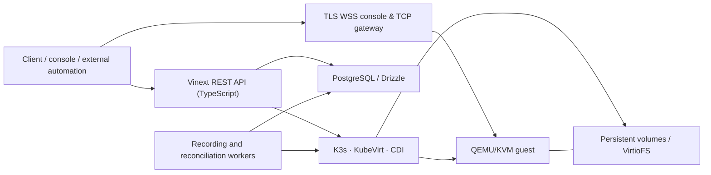

# VM Interface

**A programmable, API-first platform for real virtual machines on Kubernetes.**

VM Interface gives applications, developers and external automation systems a common way to provision, inspect and operate persistent computers. It exposes VM lifecycle, storage, display, input, file transfer and networking through versioned APIs instead of requiring clients to manipulate Kubernetes or install a proprietary agent in every guest.

[Apache-2.0](LICENSE) · [Documentation](docs/README.md) · [API guide](docs/api.md) · [Validation results](docs/validation.md) · [Changelog](CHANGELOG.md) · [Contributing](CONTRIBUTING.md)

> **Evaluation preview — hosted qualification completed on 27 November 2026 UTC.** See the [qualification record](docs/validation.md) for tested configurations and limitations. This is a source evaluation, not a production service. Use only clean, disposable, authorized devices.

## Why VM Interface?

A full VM offers its own operating system, kernel, firmware, disks and desktop/console rather than an application container alone. VM Interface puts a deliberately bounded, account-scoped API in front of KubeVirt. The client chooses how to operate the computer — a script, a human using a console client, or external automation. VM Interface provides the virtual computers and their management APIs.

- **One control surface:** declare a computer, dry-run configuration, track asynchronous operations and observe actual state.
- **Persistent computers:** retain system and exchange disks across stop/start, manage additional disks, import authorized media and export or clone owned storage.
- **Real guest interaction:** inspect the screen, connect via RFB over authenticated WSS, use exclusive input leases with human takeover and capture consented original MP4 recordings.
- **Actual file bytes:** integrity-checked uploads, guest exchange, verified downloads and published bundles.
- **Private connectivity:** scoped, expiring guest TCP tunnels; account isolation, quotas, revocation and redacted audit.
- **Evidence-first development:** native KVM tests, real guest computations, reproducible inputs and independent artifact verification rather than simulated success.

### What can I build with it?

- Disposable application-test computers with persistent state and a verifiable result.
- Remote console workflows where a human and external automation can share observation but only the current controller can send input.
- Account-isolated VM environments that exchange files, run guest services through scoped tunnels and produce original test recordings.

These are examples of hosted-qualified building blocks, not a promise of a hosted SaaS, turnkey multi-user desktop, or arbitrary OS compatibility.

## Architecture at a glance



Vinext and TypeScript implement the REST API. K3s hosts KubeVirt and CDI; QEMU/KVM supplies guest execution, while CloudNativePG/PostgreSQL stores durable account and operation state. Console, exchange and recording workers are separate services in the deployment. [Architecture and trust boundaries](docs/architecture.md). [Dedicated managed Kubernetes evaluation](docs/managed-kubernetes.md) uses explicit context, immutable registry digest and eligible KVM/CSI/CNI; no production runtime certification is claimed.

## Current capability status

| Capability                                                                                | Qualification                                                                                                                      |
| ----------------------------------------------------------------------------------------- | ---------------------------------------------------------------------------------------------------------------------------------- |
| x86_64 lifecycle, account isolation, quotas, restart/recovery                             | Hosted native KVM passed                                                                                                           |
| BIOS/UEFI boot, persistent system/exchange and data disks, cold CPU/RAM change            | Hosted native KVM passed                                                                                                           |
| Direct/resumable CDI, dual disk, registered images, cache, clone/export                   | Hosted native KVM passed                                                                                                           |
| RFB display, screenshots, keyboard/tablet, input ownership and hard reset                 | Hosted native KVM passed                                                                                                           |
| Fedora 44 application install/run, archive, guest result, original recording              | Hosted native KVM passed                                                                                                           |
| VirtioFS file exchange and private TCP tunnel                                             | Hosted native KVM passed                                                                                                           |
| CSI growth                                                                                | Qualified evaluation driver; guest exchange growth and unchanged PVC identities verified; guest boot filesystem growth not claimed |
| Android ARM64                                                                             | Offline media and APK preparation verified; native runtime not certified                                      |
| Windows                                                                                   | Driver and media preparation verified; native installation and application execution not certified                                                      |
| GPU, live migration/resize, virtio-mem, snapshots and additional hardware/OS combinations | Conditional or unverified; never assume availability                                                                               |

Full results and exact commit: [validation record](docs/validation.md). The runtime capability/schema endpoints are authoritative for allowed configurations; a supported request is not a guarantee of guest conformance.

## Implementation and migration

The current `main` already contains the consolidated Kubernetes-only implementation: Vinext and TypeScript on Node.js 24, the pinned Vite+ toolchain, daemonless OCI image construction, and KubeVirt-managed guests. All 65 former Python files are accounted for in the [migration inventory](docs/toolchain-migration.md); no legacy Python source or Dockerfile is required. Database schema initialization and compatibility upgrades are centralized in [`src/db.ts`](src/db.ts); see the [schema and upgrade guide](docs/database-schema.md).

Use `main` for evaluation source and the exact tested SHA below for reproducing hosted evidence. Historical development branches are not separate installations or required migration steps. See [repository maintenance](docs/repository-maintenance.md) for repository conventions.

## Getting started

### 1. Inspect and test the source (no KVM required)

Use Linux with Git, Node.js 24, npm, Bash, curl, FFmpeg/ffprobe (including `libx264` and `drawtext`), Tesseract with English language data, and DejaVu fonts installed. Internet access is required to download locked dependencies. On Ubuntu/Debian, the evidence prerequisites are `ffmpeg tesseract-ocr tesseract-ocr-eng fonts-dejavu-core`; install them through your distribution's trusted package manager.

```sh
git clone https://github.com/everhush/vm_interface.git
cd vm_interface
git checkout main
bash scripts/device-validate.sh checks
```

This bootstraps the locked project-local Vite+ CLI with `npm ci`, then runs `vp check` (format, type checking and lint), `vp test run`, `vp build`, the source migration guard and shell syntax checks. Node.js 24.11 or newer within the 24.x release line is required. Vinext remains the application runtime. It does not install K3s or certify a guest. Do not run provisioning scripts merely to browse the code.

### 2. Try the full evaluation on a disposable x86_64 Linux device

**Warning:** the native validation workflow provisions a new K3s cluster, downloads guest images and uses local disks and elevated privileges. Never run it on a personal production workstation, existing cluster or shared persistent runner. Review the scripts first and obtain operator consent. Use a clean source checkout; keep guest media, credentials and other private files outside the source checkout and OCI build context. Require real `/dev/kvm`, Buildah, sudo, Node.js 24, a C compiler, curl, OpenSSL, Git, FFmpeg/ffprobe, Tesseract and skopeo. The core preflight requires at least 6 GiB RAM and 35 GiB free root storage; large-media profiles require 12 GiB and 100 GiB. No TCG fallback.

```sh
# Reproduce the exact hosted-qualified implementation:
git switch --detach 34652dc2fffd585e8e95aac1a2df63b3552da8f8
sudo "$(command -v node)" scripts/device-preflight.ts --architecture amd64
bash scripts/device-validate.sh core --confirm-disposable
```

This installs the pinned operators and application, creates ephemeral test identities, exercises the product APIs and retains an `evidence/` directory. It retains the disposable cluster for inspection; the operator owns disposal. The Linux application showcase is included in core and available separately on a fresh host via the `linux` profile. For additional evaluation profiles, follow the [device guide](docs/device-validation.md).

### 3. Explore the API

With an already deployed disposable evaluation and an authorized test bearer token, forward the service only to loopback (never expose this test API publicly). In one terminal:

```sh
kubectl -n vm-interface port-forward --address 127.0.0.1 svc/vm-api 3000:3000
```

In another terminal on that dedicated host, enter an operator-provided test token without echoing it (or see [local evaluation access](docs/device-validation.md#local-evaluation-api-access) if you provisioned the cluster yourself):

```sh
export API_URL=http://127.0.0.1:3000/api/v1
set +x
read -r -s -p 'Evaluation bearer token: ' VM_TOKEN; printf '\n'
curl --fail "$API_URL/health"
curl --fail -H "Authorization: Bearer $VM_TOKEN" "$API_URL/openapi.json"
curl --fail -H "Authorization: Bearer $VM_TOKEN" "$API_URL/capabilities"
curl --fail -H "Authorization: Bearer $VM_TOKEN" "$API_URL/images"
```

See the [API guide](docs/api.md#walkthrough-create-and-operate-a-smoke-vm) for a step-by-step create/start/observe/screenshot/stop/delete example and safe retry handling. The [documentation index](docs/README.md) links to persistent storage, native-device evaluation and integration references. HTTP 202 means an operation was submitted, not that a guest action completed. The OpenAPI document is generated by the implementation. Unset `VM_TOKEN` and stop the port-forward when finished; retain the cluster only for authorized inspection.

## Evidence

The migrated hosted candidate passed **158 TypeScript tests in 59 files** (no skipped, failed or todo tests), all **13 recorded core native stages**, real CSI qualification and Android input preparation. Original H.264 guest recordings, actual guest/clone and exchange bytes, native CDI and network traces and cleanup were independently verified.

| Hosted workflow | Result |
| --- | --- |
| [Locked Vite+ static checks](https://github.com/everhush/vm_interface/actions/runs/46077697248) | Pass |
| [Core KVM + static checks](https://github.com/everhush/vm_interface/actions/runs/46077980605) | Pass |
| [Real CSI expansion](https://github.com/everhush/vm_interface/actions/runs/46078053324) | Pass |
| [Android media and signed APK preparation](https://github.com/everhush/vm_interface/actions/runs/46077983994) | Pass (offline only) |

Exact source: `34652dc2fffd585e8e95aac1a2df63b3552da8f8`. See the [migration record](docs/toolchain-migration.md) and [validation record](docs/validation.md) for original artifacts, SHA-256 digests, observed results and explicit limits. Historical pre-transfer CI evidence is separate; public upstream qualification used standard GitHub-hosted runners. Later primary documentation and CI routing changes do not represent new same-SHA qualification runs. Artifact access and retention are subject to GitHub; no raw logs, guest media or credentials are redistributed here.

## Repository map

| Path                 | Purpose                                                               |
| -------------------- | --------------------------------------------------------------------- |
| `app/`               | Vinext app and versioned API route                                    |
| `src/`               | VM schema, operations, persistence, storage, gateways and workers     |
| `infra/`             | K3s/KubeVirt/CDI/CNPG deployment and least-privilege policies         |
| `scripts/`           | Provisioning, API-only tests, media acquisition and verifiers         |
| `showcases/`         | Android APK and Windows media/guest fixtures                 |
| `tests/`             | TypeScript unit and regression checks                                 |
| `docs/`              | Public guides, qualification ledger and operational documentation |
| `.github/workflows/` | Primary-branch checks and manual qualification workflows      |

## License and security

Copyright 2026 Rituraj Basak. Source code is available under the [Apache License 2.0](LICENSE); see [NOTICE](NOTICE) and [third-party licensing](THIRD_PARTY.md). Guest images, dependencies and external artifacts retain their respective terms; this license is not permission to redistribute those images. For vulnerabilities or sensitive findings see [SECURITY.md](SECURITY.md), not a public issue. The npm package is private; no npm publication or production deployment is implied.
