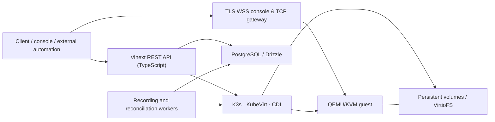

# VM Interface

**A programmable, API-first platform for real virtual machines on Kubernetes.**

VM Interface gives applications, developers and external automation systems a common way to provision, inspect and operate persistent computers. It exposes VM lifecycle, storage, display, input, file transfer and networking through versioned APIs instead of requiring clients to manipulate Kubernetes or install a proprietary agent in every guest.

[Apache-2.0](LICENSE) · [Documentation](docs/README.md) · [API guide](docs/api.md) · [Validation results](docs/validation.md) · [Contributing](CONTRIBUTING.md)

> **Evaluation preview — hosted x86_64 KVM qualification passed on 27 November 2026.** Independent native-device acceptance ([#12](https://github.com/imxade/vm_interface/issues/12)) remains pending, including native ARM64 Android. This is not a production service or a stable/certified release. Use only clean, disposable, authorized devices.

## Why VM Interface?

A full VM offers its own operating system, kernel, firmware, disks and desktop/console rather than an application container alone. VM Interface puts a deliberately bounded, account-scoped API in front of KubeVirt. The client chooses how to operate the computer — a script, a human using a console client, or external automation. VM Interface is not an AI model, agent runtime, workflow engine or cloud-capacity manager.

- **One control surface:** declare a computer, dry-run configuration, track asynchronous operations and observe actual state.
- **Persistent computers:** retain system and exchange disks across stop/start, manage additional disks, import authorized media and export or clone owned storage.
- **Real guest interaction:** inspect the screen, connect via RFB over authenticated WSS, use exclusive input leases with human takeover and capture consented original MP4 recordings.
- **Actual file bytes:** integrity-checked uploads, guest exchange, verified downloads and published bundles.
- **Private connectivity:** scoped, expiring guest TCP tunnels; account isolation, quotas, revocation and redacted audit.
- **Evidence-first development:** native KVM tests, real guest computations, reproducible inputs and independent artifact verification rather than simulated success.

### What can I build with it?

- Disposable application-test computers with persistent state and a verifiable result.
- Remote console workflows where a human and external automation can share observation but only the current controller can send input.
- Account-isolated VM environments that exchange files, run guest services through scoped tunnels and produce original test recordings.

These are examples of the hosted-qualified building blocks, not a promise of a hosted SaaS, turnkey multi-user desktop, or arbitrary OS compatibility.

## Architecture at a glance



Vinext and TypeScript implement the REST API. K3s hosts KubeVirt and CDI; QEMU/KVM supplies guest execution, while CloudNativePG/PostgreSQL stores durable account and operation state. Console, exchange and recording workers are separate services in the deployment. [Architecture and trust boundaries](docs/architecture.md).

## Current capability status

| Capability | Qualification |
| --- | --- |
| x86_64 lifecycle, account isolation, quotas, restart/recovery | Hosted native KVM passed |
| BIOS/UEFI boot, persistent system/exchange and data disks, cold CPU/RAM change | Hosted native KVM passed |
| Direct/resumable CDI, dual disk, registered images, cache, clone/export | Hosted native KVM passed |
| RFB display, screenshots, keyboard/tablet, input ownership and hard reset | Hosted native KVM passed |
| Fedora 44 application install/run, archive, guest result, original recording | Hosted native KVM passed |
| VirtioFS file exchange and private TCP tunnel | Hosted native KVM passed |
| CSI growth | Qualified evaluation driver; guest exchange growth and unchanged PVC identities verified; guest boot filesystem growth not claimed |
| Android ARM64 | Pinned media, APK and scenarios prepared; actual guest boot and runtime pending native device |
| Windows | Optional historical experiments; not a release requirement or certified guest |
| GPU, live migration/resize, virtio-mem, snapshots and additional hardware/OS combinations | Conditional or unverified; never assume availability |

Full results and exact commit: [validation record](docs/validation.md). The runtime capability/schema endpoints are authoritative for allowed configurations; a supported request is not a guarantee of guest conformance.

## Getting started

### 1. Inspect and test the source (no KVM required)

Use Linux with Node.js 24, Python 3.11+, npm, Bash, FFmpeg/ffprobe and Tesseract installed. Internet access is required to resolve locked dependencies.

```sh
git clone https://github.com/imxade/vm_interface.git
cd vm_interface
git checkout main
bash scripts/device-validate.sh checks
```

This uses `npm ci` and runs type checking, lint, TypeScript/Python tests, production build and shell syntax checks. It does not install K3s or certify a guest. Do not run provisioning scripts merely to browse the code.

### 2. Try the full evaluation on a disposable x86_64 Linux device

**Warning:** the native validation workflow provisions a new K3s cluster, downloads guest images and uses local disks and elevated privileges. Never run it on a personal production workstation, existing cluster or shared persistent runner. Review the scripts first and obtain operator consent. Require real `/dev/kvm`, Docker, sudo, Node.js 24, Python 3.11+, curl, OpenSSL, Git, FFmpeg/ffprobe, Tesseract and skopeo. The core preflight requires at least 6 GiB RAM and 35 GiB free root storage; large-media profiles require 12 GiB and 100 GiB. No TCG fallback.

```sh
# Reproduce the exact hosted-qualified implementation:
git checkout 7e095afe6274137104f15caf9cbaef7738d6a9ba
sudo python3 scripts/device-preflight.py --architecture amd64
bash scripts/device-validate.sh core --confirm-disposable
```

This installs the pinned operators and application, creates ephemeral test identities, exercises the product APIs and retains an `evidence/` directory. It retains the disposable cluster for inspection; the operator owns disposal. The Linux application showcase is included in core and available separately on a fresh host via the `linux` profile. For native ARM64 preparation and optional CSI evaluation, follow the [device guide](docs/device-validation.md).

### 3. Explore the API

With an already deployed disposable evaluation and an authorized test bearer token, forward the service only to loopback (never expose this test API publicly). In one terminal:

```sh
kubectl -n vm-interface port-forward --address 127.0.0.1 svc/vm-api 3000:3000
```

In another, use the operator-provided test token (do not commit it):

```sh
export API_URL=http://127.0.0.1:3000/api/v1
curl --fail "$API_URL/health"
curl --fail -H "Authorization: Bearer $VM_TOKEN" "$API_URL/openapi.json"
curl --fail -H "Authorization: Bearer $VM_TOKEN" "$API_URL/capabilities"
curl --fail -H "Authorization: Bearer $VM_TOKEN" "$API_URL/images"
```

See the [API guide](docs/api.md#walkthrough-create-and-operate-a-smoke-vm) for a step-by-step create/start/observe/screenshot/stop/delete example and safe retry handling. The [documentation index](docs/README.md) links to persistent storage, native-device evaluation and integration references. HTTP 202 means an operation was submitted, not that a guest action completed. The OpenAPI document is generated by the implementation.

## Evidence

The final hosted candidate passed **152 automated tests** (93 TypeScript + 59 Python), all **13 recorded core native stages**, real CSI qualification and Android input preparation. Both original H.264 guest recordings were independently decoded and matched to actual API traces and guest results.

| Hosted workflow | Result |
| --- | --- |
| [Core KVM + static checks](https://github.com/xad3play/vm_interface/actions/runs/45954535380) | Pass |
| [Real CSI expansion](https://github.com/xad3play/vm_interface/actions/runs/45954542680) | Pass |
| [Android media and signed APK preparation](https://github.com/xad3play/vm_interface/actions/runs/45954551058) | Pass (offline only) |

Actions runs were executed in a CI-only synchronized fork. Access to historical run artifacts may require repository authorization and artifacts may expire. The durable [validation record](docs/validation.md) documents run IDs, artifact digests, observed results and limitations without publishing raw logs, guest data or credentials. The upstream main branch includes documentation/license-only changes after the exact tested commit. It does not claim a new same-SHA CI result.

## Repository map

| Path | Purpose |
| --- | --- |
| `app/` | Vinext app and versioned API route |
| `src/` | VM schema, operations, persistence, storage, gateways and workers |
| `infra/` | K3s/KubeVirt/CDI/CNPG deployment and least-privilege policies |
| `scripts/` | Provisioning, API-only tests, media acquisition and verifiers |
| `showcases/` | Android APK and optional Windows media/guest fixtures |
| `tests/` | TypeScript unit and regression checks |
| `docs/` | Public guides, qualification ledger and archived design specification |
| `.github/workflows/` | Hosted qualification workflows; execution guarded to the CI fork |

## Roadmap and boundaries

Next milestone: [independent native-device acceptance (#12)](https://github.com/imxade/vm_interface/issues/12). Three consecutive comprehensive reviewed independent passes are required before stable release; current count is **0/3**. Use the [acceptance record template](docs/acceptance-record.md) to retain independent evidence and record the verdict without changing source. The current scope deliberately excludes a general dashboard, production identity/registration/OAuth, AI agents and production EKS/cloud deployment. See [release checklist](docs/release-checklist.md) and [original product specification](docs/product-specification.md) for the wider roadmap. Report defects rather than weakening test assertions.

## License and security

Copyright 2026 Rituraj Basak. Source code is available under the [Apache License 2.0](LICENSE); see [NOTICE](NOTICE) and [third-party licensing](THIRD_PARTY.md). Guest images, dependencies and external artifacts retain their respective terms; this license is not permission to redistribute those images. For vulnerabilities or sensitive findings see [SECURITY.md](SECURITY.md), not a public issue. The npm package is private; no npm publication or production deployment is implied.
